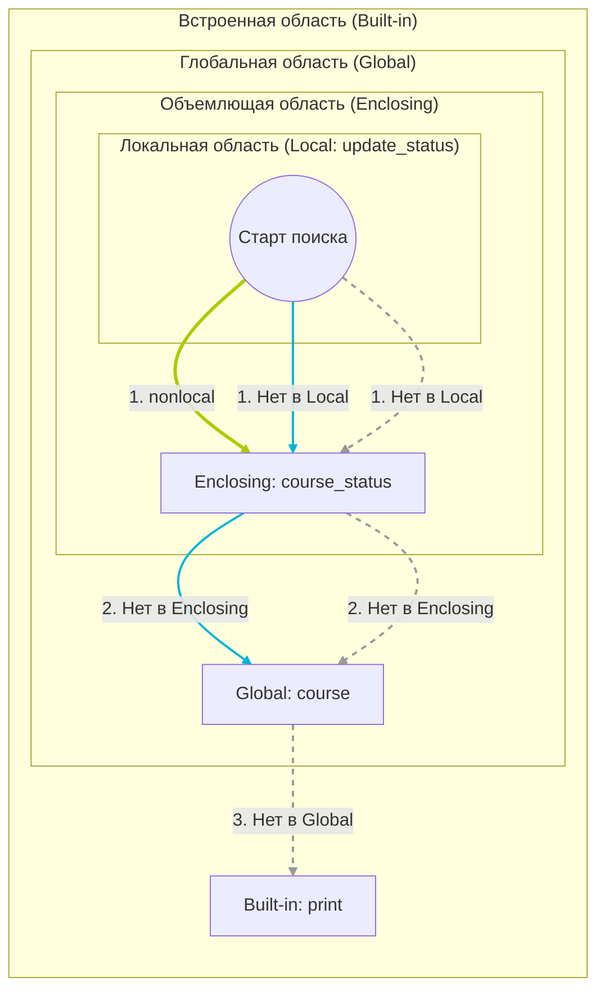

# Лабораторная работа № 3. Алгоритмы, коллекции и функции

## Цель работы

Научиться переводить условие задачи в алгоритм, выбирать подходящую структуру данных и разделять программу на небольшие функции с понятными контрактами.

---

### Задание 1. Условия и классификация данных

Программа `def projects(score, work_type, absences)` получает на вход результат студента, тип работы и кол-во пропущенных занятий

#### Часть 1

Проверка диапазонов:

```
    if score < 0 or score > 100:
        return 'Неверные входные данные'
    elif absences < 0 or absences > 5:
        return 'Неверные входные данные'
```

#### Часть 2

Определение уровня результата:

```
    if 0 <= score <= 59:
        r = 'недостаточный'
    elif (75 <= score <= 89 and absences > 3) or 60 <= score <= 74:
        r = 'удовлетворительный'
    elif (90 <= score <= 100 and absences > 3) or 75 <= score <= 89:
        r = 'хороший'
    elif 90 <= score <= 100:
        r = 'отличный'
```

#### Часть 3

Сопоставление:

```
    match work_type:
        case 'exam':
            t = 'экзаменационная работа'
        case 'project':
            t = 'проектная работа'
        case 'practice':
            t = 'практическая работа'
        case _:
            t = 'неизвестный тип работы'
```

#### Часть 4

| Входные данные | Ожидаемый результат | Фактический результат |
| ----------- | ----------- | ----------- |
| [0, 'exam', 2]    | Тип: экзаменационная работа. Уровень: недостаточный   | Тип: экзаменационная работа. Уровень: недостаточный     |
| [100, 'project', 6]    | Неверные входные данные   | Неверные входные данные     |
| [59, 'project', 0]    | Тип: проектная работа. Уровень: недостаточный   | Тип: проектная работа. Уровень: недостаточный     |
| [60, 'practice', 4]    | Тип: практическая работа. Уровень: недостаточный   | Тип: практическая работа. Уровень: недостаточный     |
| [74, 'exam', 2]    | Тип: экзаменационная работа. Уровень: удовлетворительный   | Тип: экзаменационная работа. Уровень: удовлетворительный     |
| [75, 'practice', 5]    | Тип: практическая работа. Уровень: удовлетворительный   | Тип: практическая работа. Уровень: удовлетворительный     |
| [89, 'project', 9]    | Неверные входные данные   | Неверные входные данные     |
| [90, 'classwork', 3]    | Тип: неизвестный тип работы. Уровень: отличный   | Тип: неизвестный тип работы. Уровень: отличный     |

- Сначала отсекаются некорректные входные данные (`score` меньше 0 или больше 100, `absences` меньше 0 или больше 5), далее проверяются данные для назначения уровня "недостаточный". Если условия выполняются, все остальные elif пропускаются, иначе проверяем дальше и назначаем соответствующий уровень.
- При выбранном порядке все ветви являются достижимыми, то есть не может получиться так, что, например, при `score = 95` и `absences = 2` будет присвоен несоответствующий уровень (последняя ветка не выполнялась бы никогда, соответственно была бы недостижимой)

#### Практическое расширение

```
Студент №1: Тип: экзаменационная работа. Уровень: отличный
Студент №2: Тип: проектная работа. Уровень: удовлетворительный
Студент №3: Тип: практическая работа. Уровень: хороший
Студент №4: Тип: экзаменационная работа. Уровень: недостаточный
Студент №5: Тип: проектная работа. Уровень: недостаточный
Студент №6: Тип: практическая работа. Уровень: хороший
Студент №7: Тип: экзаменационная работа. Уровень: удовлетворительный
Студент №8: Тип: неизвестный тип работы. Уровень: хороший
Студент №9: Тип: практическая работа. Уровень: недостаточный
Студент №10: Тип: проектная работа. Уровень: отличный

--Итоговая сводка--
Уровень "отличный": 2 чел.
Уровень "хороший": 3 чел.
Уровень "удовлетворительный": 2 чел.
Уровень "недостаточный": 3 чел.
```

### Задание 2. Циклы и базовые алгоритмические схемы

```python
measurements = [12, 15, 11, 18, 18, 9, 21, 15, 7, 18]
# Вычисление суммы
s = 0
for i in measurements: s += i

# Поиск максимального значения
mx = 0
for j in measurements:
    if j > mx: mx = j

# Поиск минимального значения
mn = mx
for k in measurements:
    if k < mn: mn = k

# Подсчет четных значений
ch = 0
for h in measurements:
    if h % 2 == 0: ch += h

# Подсчет значений, превосходящих среднее арифметическое
ll = 0
for t in measurements: ll += 1
sr = s / ll
psr = 0
for f in measurements:
    if f > sr: psr += f

# Линейный поиск
def where(nt):
    for y in range(ll):
        if measurements[y] == nt:
            return y
    return -1
```

**Дополнительный алгоритмический эксперимент**

Проверка простоты числа:

```python
def prost(c):
    for q in range(2, int(c ** 0.5) + 1):
        if c % q == 0: return False
    return True
```

| Алгоритм | Временная сложность | Параметр | Доп. память |
| ----------- | ----------- | ----------- | ----------- |
| Сумма    | O(n)   | кол-во эл-ов N    | O(1) |
| Максимальное значение    | O(n)   | кол-во эл-ов N     | O(1) |
| Минимальное значение    | O(n)  | кол-во эл-ов N     | O(1) |
| Подсчет чётных    | O(n)   | кол-во эл-ов N     | O(1) |
| Подсчет значений, больших ср. арифм.    | O(n)   | кол-во эл-ов N     | O(1) |
| Линейный поиск    | O(n) (в лучшем случае O(1))  | кол-во эл-ов N и расположение искомого числа     | O(1) |
| Проверка простоты числа    | O(n ** 0.5)   | Величина проверяемого числа     | O(1) |

- Ограничение делителей квадратным корнем корректно, так как все делители числа имеют пару: число c можно представить как умножение axb, если a является делителем числа c, то и парный элемент b тоже будет его делителем.

**Практическое расширение**

```python
# Сортировка выбором
def selectionsort(kol, x):
    for i in range(kol):
      ch = min(x[i::])
      ind = x[i::].index(ch)
      x[i], x[ind + i] = x[ind + i], x[i]
    return x

# Бинарный поиск
def binary(sp, l, h, nt):
  sr = 0
  while l <= h:
    mid = (l + h) // 2
    sr += 1
    if sp[mid] == nt:
      return mid, sr
    elif sp[mid] > nt:
      h = mid - 1
    else:
      l = mid + 1
  return -1, sr

# Линейный поиск
def linear(sp, nt, kol):
    sr = 0
    for y in range(kol):
        sr += 1
        if sp[y] == nt:
            return y, sr
    return -1, sr
```

| Размер списка | Сравнения линейным поиском | Сравнения бинарным поиском |
| ----------- | ----------- | ----------- |
| 10 эл-ов    | 9 (0.00001242 sec) | 2 (0.00000371 sec)  |
| 100 эл-ов    | 88 (0.00000654 sec)  | 7 (0.00000329 sec)  |
| 1000 эл-ов    | 982 (0.00010242 sec)  | 8 (0.00000417 sec)  |

### Задание 3. Коллекции и выбор структуры данных

Вывод множества студентов, всех сданных работ, словаря со списками попыток студента, словаря с лучшими результатами и словаря кол-ва попыток по ключу `(student, laboratory)`, а также студенты, которые сдали обе работы:
```python
{'daria', 'anna', 'boris'}
{'lab_02', 'lab_01'}
{'anna': [['lab_01', 5], ['lab_02', 5], ['lab_01', 4]], 'boris': [['lab_01', 4], ['lab_02', 5]], 'daria': [['lab_01', 3]]}
{('anna', 'lab_01'): 5, ('boris', 'lab_01'): 4, ('anna', 'lab_02'): 5, ('daria', 'lab_01'): 3, ('boris', 'lab_02'): 5}
{('anna', 'lab_01'): 2, ('boris', 'lab_01'): 1, ('anna', 'lab_02'): 1, ('daria', 'lab_01'): 1, ('boris', 'lab_02'): 1}
Студенты, которые сдали обе работы: {'anna', 'boris'}
```

Добавление новой записи и обновление структур:

```python
new = ('liza', "lab_02", 5)
new_s, new_l, new_o = new
submissions.append(new)
students.add(new_s)
labs.add(new_l)
tries[new_s] = []
tries[new_s].append([new_l, new_o])
key = (new_s, new_l)
best_res[key] = new_o
tries_lab[key] = 1
```

Новый вывод структур:
```python
{'liza', 'boris', 'anna', 'daria'}
{'lab_01', 'lab_02'}
{'anna': [['lab_01', 5], ['lab_02', 5], ['lab_01', 4]], 'boris': [['lab_01', 4], ['lab_02', 5]], 'daria': [['lab_01', 3]], 'liza': ['lab_02', 5]}
{('anna', 'lab_01'): 5, ('boris', 'lab_01'): 4, ('anna', 'lab_02'): 5, ('daria', 'lab_01'): 3, ('boris', 'lab_02'): 5, ('liza', 'lab_02'): 5}
{('anna', 'lab_01'): 2, ('boris', 'lab_01'): 1, ('anna', 'lab_02'): 1, ('daria', 'lab_01'): 1, ('boris', 'lab_02'): 1, ('liza', 'lab_02'): 1}
```

- Множество подходит для хранения уникальных значений потому, что оно по определению не может содержать одинаковые элементы, поэтому при попытке добавить уже существующий элемент структура игнорирует операцию
- Кортеж можно использовать как ключ словаря так как он неизменяемый и имеет хэш (словарь устроен на основе хэш-таблиц, чтобы объект мог быть ключом, его хэш-значение должно быть постоянным)
- Список нельзя использовать как ключ словаря поскольку является изменяемым типом данных, и если его содержимое поменяется, поменяется и его хэш, что разрушит структуру хэш-таблицы
- Словарь предпочтительнее списка для частого поиска результата по составному ключу потому что компьютер мгновенно считает хэш ключа и сразу переходит к ячейке памяти, вместо того, чтобы применять линейный поиск в списке

Оценка средней сложности:
| Структура данных | Добавление | Поиск |
| ----------- | ----------- | ----------- |
| Список `list`    | О(1) | О(n)  |
| Множество `set`    | О(1)  | О(1)  |
| Словарь `dict`    | О(1)  | О(1)  |

**Практическое расширение**

Входные данные:

```python
'student anna'
'best anna lab_01'
'attempts boris lab_02'
'completed lab_01'
'student ivan'
```

Выходные данные:

```python
student anna
Попытки anna: [['lab_01', 5], ['lab_02', 5], ['lab_01', 4]]
-
best anna lab_01
Лучший результат anna по lab_01: 5
-
attempts boris lab_02
Количество попыток boris по lab_02: 1
-
completed lab_01
Работу lab_01 сдавали: {'boris', 'daria', 'anna'}
-
student ivan
Студент 'ivan' не найден.
-
```

### Задание 4. Функции, параметры и области видимости



