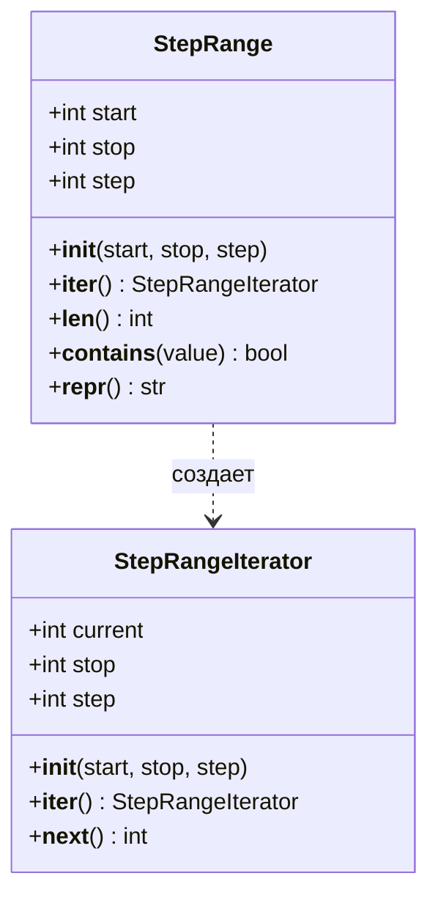
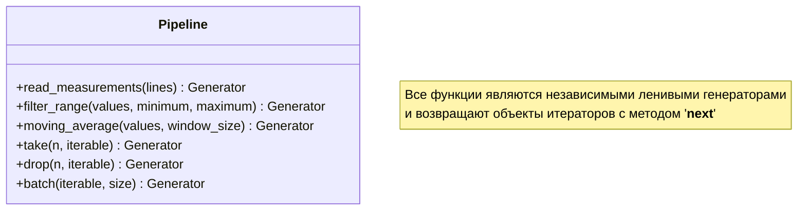
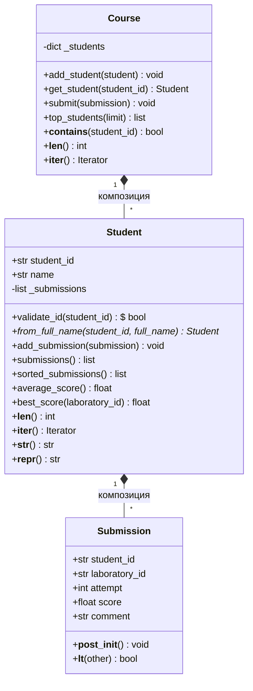
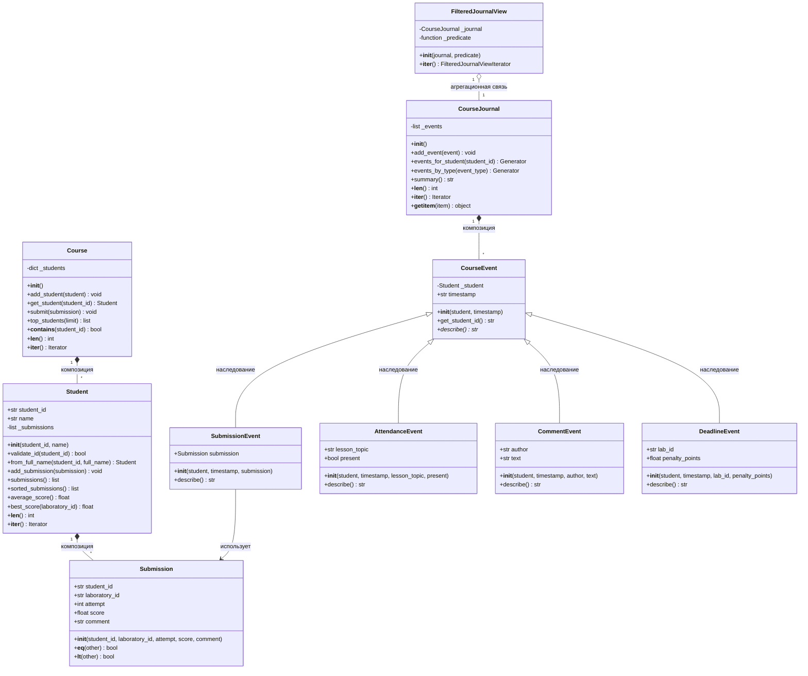

# Лабораторная работа № 4. Итераторы, генераторы и объектная модель Python

## Цель работы

Понять механизмы, лежащие в основе цикла `for`, научиться создавать ленивые последовательности и проектировать собственные типы, поддерживающие стандартные протоколы Python.

## Задание 1. Протокол итерации

Результат исследования:

```
False
True
10
20
30
```

Функция `consume`:

```python
def consume(iterable) -> list:
    result = []
    i = iter(iterable)
    while True:
        try:
            item = next(i)
            result.append(item)
        except StopIteration:
            break
    return result
```
```
--Проверка функции--
Список: [1, 2, 3]
Кортеж: [1, 2, 3]
Строка: ['H', 'e', 'l', 'l', 'o']
Объект range: [0, 1, 2, 3, 4]
Частично использованный итератор (после 2 вызовов next): [300, 400]

--Сравнение повторного обхода--
Список - обход 1: ['A', 'B', 'C']
Список - обход 2: ['A', 'B', 'C']
Итератор - обход 1: ['A', 'B', 'C']
Итератор - обход 2: []
```

Результаты отличаются потому, что список — это многоразовый итерируемый объект, а итератор — это одноразовый указатель состояния. При передаче списка функция iter() каждый раз создает для него абсолютно новый итератор, который начинает обход с самого первого элемента. Если же передать сам итератор, то при вызове iter() он возвращает самого себя, но его внутренний указатель после первого прохода уже находится в конце данных.

**Практическое расширение**

Функции `my_enumerate` и `my_zip`:

```python
def my_enumerate(iterable, start=0):
    result = []
    counter = start
    it = iter(iterable)
    while True:
        try:
            item = next(it)
            result.append((counter, item))
            counter += 1
        except StopIteration:
            break
    return result


def my_zip(first, second):
    result = []
    it1 = iter(first)
    it2 = iter(second)
    while True:
        try:
            item1 = next(it1)
            try:
                item2 = next(it2)
            except StopIteration:
                break
            result.append((item1, item2))
        except StopIteration:
            break
    return result
```

Результат тестирования:

```
--my_enumerate--
список: [(1, 10), (2, 20), (3, 30)]
StepRange: [(0, 1), (1, 4), (2, 7)]

--my_zip--
строка и список (одинаковая длина): [('A', 10), ('B', 20), ('C', 30)]
StepRange и строка (StepRange длиннее строки): [(1, 'H'), (4, 'i')]
```
*Вопросы:*

1. Функция iter() для итерируемого объекта должна возвращать новый объект-итератор
2. После исчерпания данных next() обязан вызывать ошибку StopIteration при каждом последующем вызове
3. Итератор обычно возвращает себя для универсальности и совместимости (разные инструменты в Python могут работать друг с другом по одинаковым правилам, без написания отдельного кода для каждого случая)

## Задание 2. Собственный итератор

Класс `StepRange`:

```python
class StepRangeIterator:
    def __init__(self, start: int, stop: int, step: int) -> None:
        self.current = start
        self.stop = stop
        self.step = step
    def __iter__(self) -> "StepRangeIterator":
        return self
    def __next__(self) -> int:
        if self.step > 0 and self.current >= self.stop:
            raise StopIteration
        if self.step < 0 and self.current <= self.stop:
            raise StopIteration
        result = self.current
        self.current += self.step
        return result

class StepRange:
    def __init__(self, start: int, stop: int, step: int = 1) -> None:
        if step == 0:
            raise ValueError("Шаг диапазона не может быть равен нулю.")
        self.start = start
        self.stop = stop
        self.step = step
    def __iter__(self) -> StepRangeIterator:
        return StepRangeIterator(self.start, self.stop, self.step)
```

Результат тестирования:

```
[0, 1, 2, 3, 4]
[5, 4, 3, 2, 1]
[]
[]
```
```
--Работа двух независимых итераторов--
Вызов next(it1): 0
Вызов next(it1): 2
Вызов next(it2): 0
Вызов next(it1): 4
```

Состояние итераторов после каждого шага:
| Шаг/Действие | it1 | it2 |
| ----------- | ----------- |----------- |
| next(it1)   | 2   |0   |
| next(it1)    | 4   |0   |
| next(it2)   | 4   |2   |
| next(it1)   | 6   |2   |

**Практическое расширение:**

```python
    def __len__(self) -> int:
        if self.step > 0 and self.start >= self.stop:
            return 0
        if self.step < 0 and self.start <= self.stop:
            return 0
        return (self.stop - self.start - 1) // self.step + 1

    def __contains__(self, value: int) -> bool:
        if self.step > 0 and (value < self.start or value >= self.stop):
            return False
        if self.step < 0 and (value > self.start or value <= self.stop):
            return False
        return (value - self.start) % self.step == 0

    def __repr__(self) -> str:
        return f"StepRange({self.start}, {self.stop}, {self.step})"
```
Результат тестирования:

```
--Практическое расширение--
__repr__(): StepRange(0, 30000000, 3)
__len__():  10000000
Проверка числа 29999997 через in: True
Проверка числа 1000 через in: False
```

При проверке через `__contains__()` (сложность О(1) выполняется всего несколько операций: проверяет границы и делится ли разница на шаг без остатка, а при проверке обходом (сложность О(N)) большого диапазона будет выполнятся несколько тысяч (а то и миллионов) операций.

*Вопросы:*

1. Состояние обхода лучше хранить в отдельном объекте, чтобы разделить неизменяемую структуру данных и процесс её обхода. Создание отдельного объекта-итератора при каждом вызове iter() позволяет запускать несколько независимых проходов по одному диапазону одновременно
2. Сломается возможность повторного обхода диапазона и логика вложенных циклов
3. `StepRange` требует константный объем памяти — \(O(1)\), независимо от общего числа элементов в последовательности поскольку класс  хранит всего три целых числа — start, stop и step



## Задание 3. Генераторы и ленивый конвейер

Генераторы:

```python
def read_measurements(lines) -> object:
    for line in lines:
        cleaned = line.strip()
        if cleaned != "":
            yield float(cleaned)


def filter_range(values, minimum: float, maximum: float) -> object:
    for value in values:
        if minimum <= value <= maximum:
            yield value


def moving_average(values, window_size: int) -> object:
    if window_size < 1:
        raise ValueError("Размер окна должен быть не меньше 1.")
    window = []
    window_sum = 0.0
    for value in values:
        window.append(value)
        window_sum += value
        if len(window) > window_size:
            removed = window.pop(0)
            window_sum -= removed
        if len(window) == window_size:
            yield window_sum / window_size
```

Результат тестирования:

```
--Тестирование работы конвейера--
Первое значение конвейера: 11.333333333333334
Второе значение конвейера: 12.333333333333334
Оставшиеся значения в списке: [11.333333333333334]

Повторный проход по исчерпанному генератору:
Результат повторного обхода: []

Новый конвейер:
Результат нового конвейера целиком: [11.333333333333334, 12.333333333333334, 11.333333333333334]

--Тестирование дополнительных выражений--
Список квадратов четных чисел: [4, 16, 36, 64, 100, 144, 196, 256, 324, 400]
Множество длин непустых строк: {4, 5, 6}
Словарь число -> квадрат: {1: 1, 2: 4, 3: 9, 4: 16, 5: 25, 6: 36, 7: 49, 8: 64, 9: 81, 10: 100}
Сумма квадратов диапазона 1-1,000,000: 333333833333500000
```

Включение работает «жадно», а генераторное выражение — «лениво». Включение сразу выделяет память под всю структуру данных целиком, а генераторное выражение помнит только формулу вычисления и индекс текущего шага.

**Практическое расширение**

Генераторы:

```python
def take(n: int, iterable) -> object:
    iterator = iter(iterable)
    for _ in range(n):
        try:
            yield next(iterator)
        except StopIteration:
            break

def drop(n: int, iterable) -> object:
    iterator = iter(iterable)
    for _ in range(n):
        try:
            next(iterator)
        except StopIteration:
            break
    for item in iterator:
        yield item

def batch(iterable, size: int) -> object:
    if size < 1:
        raise ValueError("Размер пакета должен быть не меньше 1.")
    iterator = iter(iterable)
    while True:
        current_batch = []
        for _ in range(size):
            try:
                current_batch.append(next(iterator))
            except StopIteration:
                break
        if not current_batch:
            break
        yield current_batch
```

Результат тестирования:

```
Сформированные пакеты значений: [[12.333333333333334, 11.333333333333334]]

--tracemalloc--
Пиковая память ЛЕНИВОГО конвейера: 1808 байт
Пиковая память ЖАДНОГО конвейера:  9295536 байт
```


## Задание 4. Модель предметной области

Результат тестирования:

```
--Проверка создания посылок и инвариантов--
Создана посылка:
  Submission(student_id='st_101', laboratory_id='lab_1', attempt=1, score=85.0, comment='')

--Проверка альтернативного конструктора (через временный фабричный объект)--
Инициализация через __repr__: Student(student_id='st_101', name='Иван Иванов')
Студент Иван Иванов (ID: st_101), средний балл: 83.5
Всего попыток сдачи (__len__): 3

--Проверка защиты приватного списка и сортировки работ--
Длина до попытки внешнего вмешательства: 3
Длина после попытки внешнего вмешательства: 3
Отсортированный порядок (снаружи):
  Попытка: 1, Балл: 60.0
  Попытка: 1, Балл: 95.0
  Попытка: 2, Балл: 90.0

--Тестирование класса Course и рейтинга лучших--
Рейтинг студентов:
  1 место: Анна Сидорова со средним баллом 100.00
  2 место: Иван Иванов со средним баллом 83.50
  3 место: Петр Петров со средним баллом 81.67
```

1. Диаграмма классов:

2. Технически в коде Python объекты Submission создаются во внешнем сценарии и передаются в класс Student через метод, что формально относится к агрегации. Однако, благодаря тому, что класс Student полностью скрывает этот список внутри себя (self._submissions), контролирует добавление работ и выдает наружу только независимые копии через list(), эта связь на практике работает как композиция. Время жизни посылок внутри системы жестко привязано к времени жизни объекта студента — они уничтожаются вместе с ним
3. Если бы мы сделали наследование, у Студента появились бы странные свойства, вроде оценки за самого себя, что полностью ломает логику программы. Вместо наследования мы используем связь «Студент содержит в себе посылки».
4. - Submission: Не дает поставить оценку меньше 0 или больше 100, а также запрещает делать «нулевую» или отрицательную попытку.
   - Student: Проверяет, чтобы ему случайно не записали чужую лабораторную работу (сверяет ID). submissions() выдает наружу только копию списка. Это нужно, чтобы никто не мог «взломать» программу снаружи и тайно удалить или изменить оценку в обход официального метода add_submission.
   - Course: Не позволяет зарегистрировать двух студентов с одинаковым ID и проверяет, существует ли студент, перед тем как принять у него лабораторную.
5.
```
# 1. Функция len() считает количество элементов
print(len(course))  # Покажет, сколько всего студентов на курсе
print(len(student))  # Покажет, сколько попыток сдачи сделал этот студент

# 2. Функция iter() и цикл for позволяют перебирать элементы
for sub in student:
    print(sub.score)  # Просто бежим по всем оценкам студента без сложных конструкций

for st in course:
    print(st.name)  # Спокойно перебираем всех студентов на курсе

# 3. Оператор in мгновенно ищет элемент
if "st_101" in course:
    print("Этот студент точно учится на курсе!")
```

## Задание 5. Расширяемый журнал учебного курса

Результат демонстрационного сценария:

```
=== 1. Подготовка демонстрационной базы данных ===
Журнал активности курса (10 записей)
Всего событий: 10 (Сдачи: 4, Посещения: 3, Комментарии: 3)
Проверка связности: средний балл st1 пересчитан автоматически: 70.0

=== 2. Срез журнала (первые 3 записи через __getitem__) ===
[09:00] Иван Иванов присутствовал на занятии по теме: 'Введение в итераторы'.
[09:02] Петр Петров присутствовал на занятии по теме: 'Введение в итераторы'.
[09:05] Анна Сидорова отсутствовал на занятии по теме: 'Введение в итераторы'.

=== 3. Выборка событий студента st_101 (Ленивый генератор) ===
[09:00] Иван Иванов присутствовал на занятии по теме: 'Введение в итераторы'.
[10:15] Иван Иванов сдал работу lab_1 (Попытка 1) на 45.0 баллов.
[10:20] Профессор оставил отзыв для Иван Иванов: 'Слабая оптимизация. Нужно переделать.'.
[14:00] Иван Иванов сдал работу lab_1 (Попытка 2) на 95.0 баллов.

=== 4. Выборка событий типа CommentEvent (Ленивый генератор) ===
[10:20] Профессор оставил отзыв для Иван Иванов: 'Слабая оптимизация. Нужно переделать.'.
[11:45] Тьютор оставил отзыв для Петр Петров: 'Зачтено автоматически.'.
[15:30] Профессор оставил отзыв для Анна Сидорова: 'Хороший отчет.'.

=== 5. Полная временная шкала курса (Полиморфизм) ===
[09:00] Иван Иванов присутствовал на занятии по теме: 'Введение в итераторы'.
[09:02] Петр Петров присутствовал на занятии по теме: 'Введение в итераторы'.
[09:05] Анна Сидорова отсутствовал на занятии по теме: 'Введение в итераторы'.
[10:15] Иван Иванов сдал работу lab_1 (Попытка 1) на 45.0 баллов.
[10:20] Профессор оставил отзыв для Иван Иванов: 'Слабая оптимизация. Нужно переделать.'.
[14:00] Иван Иванов сдал работу lab_1 (Попытка 2) на 95.0 баллов.
[11:30] Петр Петров сдал работу lab_1 (Попытка 1) на 80.0 баллов.
[11:45] Тьютор оставил отзыв для Петр Петров: 'Зачтено автоматически.'.
[15:10] Анна Сидорова сдал работу lab_1 (Попытка 1) на 75.0 баллов.
[15:30] Профессор оставил отзыв для Анна Сидорова: 'Хороший отчет.'.

=== 6. Расчет статистики по оценкам через протокол ScoreView ===
Всего извлечено оценок: 4
Средний балл всех сдач на курсе: 73.75
Список всех оценок при повторном обходе: [45.0, 95.0, 80.0, 75.0]
```

| Механизм | Где использован | Суть связи | Для чего применен |
| ----------- | ----------- | ----------- | ----------- |
| Наследование    | CourseEvent -> SubmissionEvent, AttendanceEvent, CommentEvent  | "является"   | Обеспечивает полиморфизм. Функция render_timeline() вызывает общий метод describe() без цепочек isinstance   | 
| Композиция   | CourseJournal хранит _events, Student хранит _submissions  | "содержит"   | Обеспечивает инкапсуляцию. Оригинальные изменяемые списки скрыты, методы выдают наружу безопасные копии   | 
| Протоколы Python    | методы __iter__, __len__, __getitem__ в журналах и ScoreView   | "ведет себя как"   | Реализует нативный обход. Позволяет объектам порционно выдавать данные «по требованию» с расходом памяти O(1)   | 

**Практическое расширение**

Результат тестирования:

```
=== 1. Проверка полиморфизма с новым типом DeadlineEvent ===
[10:15] Иван Иванов сдал работу lab_1 (Попытка 1) на 85.0 баллов.
[12:00] ВНИМАНИЕ: Наступил дедлайн по Лабораторная 2 для Иван Иванов. Штраф: 5.0 б.
[12:00] ВНИМАНИЕ: Наступил дедлайн по Лабораторная 2 для Петр Петров. Штраф: 10.0 б.

=== 2. Ленивая фильтрация через именованную функцию (Только сдачи) ===
[10:15] Иван Иванов сдал работу lab_1 (Попытка 1) на 85.0 баллов.

=== 3. Ленивая фильтрация через lambda (Только дедлайны студента st_101) ===
[12:00] ВНИМАНИЕ: Наступил дедлайн по Лабораторная 2 для Иван Иванов. Штраф: 5.0 б.

=== 4. Проверка поддержки протокола повторного обхода ===
Первый обход lambda-представления:
[12:00] ВНИМАНИЕ: Наступил дедлайн по Лабораторная 2 для Иван Иванов. Штраф: 5.0 б.
Повторный обход lambda-представления:
[12:00] ВНИМАНИЕ: Наступил дедлайн по Лабораторная 2 для Иван Иванов. Штраф: 5.0 б.
```

Диаграмма классов:



## Вывод

Механизм Python Data Model позволяет связывать наши собственные классы со встроенными командами языка: если мы добавили в класс метод __iter__, объект сразу умеет работать в цикле for, добавили __len__ — его понимает функция len(), добавили __lt__ — работает стандартная сортировка sorted(), добавили __getitem__ — активируются срезы [:]. Использование этих методов вместе с ленивыми итераторами позволяет обрабатывать данные «по требованию»
